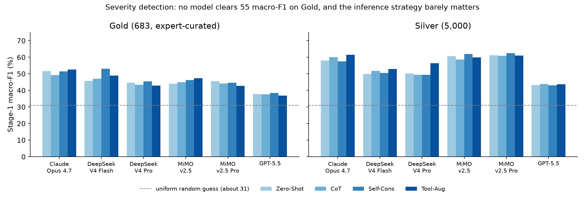
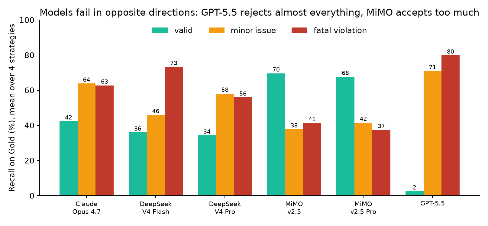
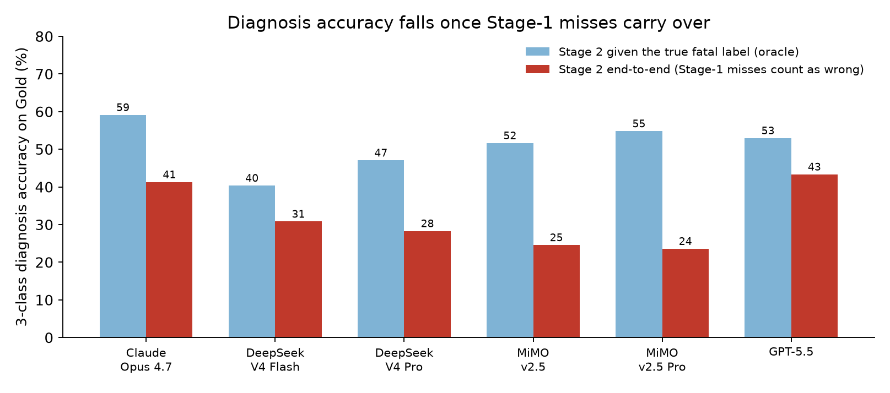

<div align="center">


# PhysDox: Benchmarking LLMs on Physical Feasibility Auditing of Physiological Sensing Protocols

[](https://aclanthology.org/2026.findings-emnlp.264/)
[](https://arxiv.org/abs/2606.05003)
[](https://huggingface.co/datasets/phishphish/PhysDox)
[](https://huggingface.co/datasets/phishphish/PhysDox-Gold)
[](LICENSE)
[](LICENSE-DATA)

**He Liu · Boyuan Gu · Shuaiqi Cheng · Haiyang Sun · Siyu You · Xuming Hu**

[Why](#why-physdox) · [Try it](#try-it-in-two-minutes) · [Example](#what-an-item-looks-like) · [Results](#results-and-what-they-mean) · [Data](#get-the-data) · [Use your model](#evaluate-your-own-model) · [Cite](#citation)

</div>

---

## Why PhysDox

An LLM can write an experimental protocol that reads perfectly and still cannot work:
the sampling rate is below the Nyquist limit, a metal plate sits between the radar and the
subject, or a healthy volunteer is given an arterial catheter. We call this a **Physical Paradox**.
PhysDox measures whether a model can catch it.

<p align="center">
  
</p>

## Try it in two minutes

No API key needed. This runs the real pipeline (data download, prompting, parsing, metrics) against a
fake model so you can check your setup first.

```bash
git clone https://github.com/phish-tech/PhysDox.git && cd PhysDox
uv sync                                          # Python 3.11+, installs the package and the physdox-eval command

uv run python examples/mock_llm_server.py &      # fake OpenAI-compatible endpoint on :8765 (or run it in a second terminal)
export LLM_API_KEY=dummy LLM_BASE_URL=http://127.0.0.1:8765/v1 LLM_MODEL_NAME=mock
uv run physdox-eval --data gold_dev --model custom --stage1-only
```

On Windows PowerShell, set the variables with `$env:LLM_API_KEY="dummy"` and so on.

You get a result table like this (the mock answers at random, so the scores mean nothing):

```text
=== PhysDox result ===
model: mock   strategy: zero-shot   items: 100
Stage 1  accuracy 34.0%   balanced acc 28.4%   macro-F1 28.3%
label              precision   recall      f1  support
valid                  28.6%    23.5%   25.8%       34
minor_issue             6.7%    18.2%    9.8%       11
fatal_violation        57.1%    43.6%   49.5%       55
confusion (rows = truth, columns = prediction):
                        valid  minor_iss  fatal_vio  __missing
valid                       8         10         16          0
minor_issue                 7          2          2          0
fatal_violation            13         18         24          0
```

## Evaluate your own model

Point the same command at any OpenAI-compatible endpoint (OpenAI, DeepSeek, vLLM, Ollama, a gateway, ...):

```bash
export LLM_API_KEY=sk-...  LLM_BASE_URL=https://api.openai.com/v1  LLM_MODEL_NAME=gpt-4o

uv run physdox-eval --data gold_dev --model custom --stage1-only        # 100 items, a few minutes
uv run physdox-eval --data silver   --model custom --max-items 500 --sample-seed 0   # random 500 of Silver, both stages
uv run physdox-eval --data silver   --model custom --strategy cot       # full Silver, chain-of-thought
```

| Option | Meaning |
|---|---|
| `--data` | `silver` (5,000), `gold_dev` (100), `gold` (683, needs access), or a JSON path/URL. Downloaded and cached automatically |
| `--strategy` | `zero-shot` (default), `cot`, `self-cons`, `tool-aug` |
| `--stage1-only` | Skip diagnosis and only classify severity |
| `--max-items N --sample-seed S` | Evaluate a random subset of N items |
| `--concurrency`, `--rpm` | Parallel requests and rate limit. Lower them if your provider returns 429/502 |

Runs write `summary.json`, `per_item_results.jsonl`, and a `README.md` under `experiments/`. Pass
`--output-dir` to make an interrupted run resumable. The result table above is printed at the end.

## What an item looks like

Every item is a full protocol (equipment, placement, acquisition, processing). This one is from the
public Gold dev subset:

> **Radar vital-sign monitoring** with three FMCW radars (24, 60, and 77 GHz).
> *"Chirp repetition frequency set to 1 kHz … Sampling rate: 0.1 MSPS"* …
>
> **Label:** `fatal_violation` · **Category:** Signal & Sampling · **Constraint:** `sampling_theorem`
>
> **Why:** the annotation computes a beat frequency of about 80 kHz for a target at 3 m, which needs
> at least 160 kHz sampling. 100 kSPS aliases, so range and vital-sign extraction cannot work.

A model that reads the protocol as a well-organized radar study and answers `valid` has fallen for the
paradox. Stage 1 asks for `valid`, `minor_issue`, or `fatal_violation`. Stage 2 asks which constraint
(3 coarse categories, 12 fine ones) the fatal protocol violates.

## At a glance

| | |
|---|---|
| **Gold set** | 683 expert-curated protocols (232 valid, 74 minor issue, 377 fatal violation) |
| **Silver set** | 5,000 protocols with balanced constraint coverage (1,500 / 1,250 / 2,250) |
| **Domains** | EEG/BCI, PPG blood pressure, IMU motion, radar vital signs, sEMG gesture, throat-mic speech |
| **Evaluated** | 6 LLM variants × 4 inference strategies × 2 splits = 48 runs |
| **Best result** | Stage-1 macro-F1 of only **53.0** on Gold |

<p align="center">
  
</p>

## Results and what they mean

All numbers below come from the 48 released runs. Charts are rebuilt by
`scripts/make_result_figures.py` from the public result tables.

### 1. Severity detection is hard, and reasoning tricks do not help

<p align="center">
  
</p>

The best Gold macro-F1 is 53.0, against about 31 for a uniform random guess. Five of six models score
lower on Gold than on Silver at their best strategy (DeepSeek V4 Flash is about equal), so the
expert-written protocols are harder than the expanded ones. Averaged over models, the four strategies
land within 2.2 points of each other on Gold (44.4 for CoT to 46.6 for self-consistency). Thinking longer
or sampling more does not fix a missing sense of physical feasibility.

### 2. Models are wrong in different directions

<p align="center">
  
</p>

Similar macro-F1 hides opposite behavior. GPT-5.5 recognizes only 2% of the valid Gold protocols and
flags nearly everything as flawed, which also gives it the highest fatal recall (80%). Both MiMO models
approve about 70% of the valid protocols but catch only 37–41% of the fatal ones. Claude Opus 4.7 is the
most balanced. A single accuracy number would hide this, so report per-class recall, not just macro-F1.

### 3. Errors cascade into diagnosis

<p align="center">
  
</p>

If a model is told which protocols are fatal, it names the right 3-class category 40–59% of the time.
Run end-to-end, so that fatal protocols missed in Stage 1 count as wrong, accuracy falls to 24–43%.
Averaged over the 24 Gold runs it drops from 51% to 32%. The protocols a model misses in Stage 1
are exactly the ones where it also lacks the physics for Stage 2, so the two errors are correlated.

### 4. Why models miss: scaffold bias

<p align="center">
  
</p>

In both cases, the protocol carries a complete, professional-looking pipeline (2D-FFT and phase
extraction; PTT terminology and AAMI/BHS-style validation), and the models read that as evidence of
validity. The paper calls this **scaffold bias** and reports that implicit constraints, such as material
blocking or clinical safety, are missed about **2×** as often as explicit hardware violations
(ρ = 0.81, p < 0.01). A trace analysis of false negatives splits them into 54% attention failures and
46% judgment failures.

### Leaderboard

Stage-1 macro-F1 (%), best of four strategies per model. See [LEADERBOARD.md](LEADERBOARD.md) to add yours.

| Model | Gold | Silver |
|---|---:|---:|
| DeepSeek V4 Flash | **53.0** | 52.9 |
| Claude Opus 4.7 | 52.6 | 61.4 |
| MiMo v2.5 | 47.4 | 62.0 |
| MiMo v2.5 Pro | 45.6 | **62.4** |
| DeepSeek V4 Pro | 45.5 | 56.4 |
| GPT-5.5 | 38.5 | 43.9 |

## Get the data

```python
from datasets import load_dataset

silver   = load_dataset("phishphish/PhysDox", "silver",   split="train")  # 5,000 items
gold_dev = load_dataset("phishphish/PhysDox", "gold_dev", split="train")  # 100 items with labels
```

The full 683-item Gold set is **gated** so that it stays out of training data and the Gold numbers stay
trustworthy. [Request access](https://huggingface.co/datasets/phishphish/PhysDox-Gold) with your affiliation
and intended use, then run `export HF_TOKEN=...` and use `--data gold`. Gold may be used for evaluation only. It
may not be used for training or redistributed.

## Reproduce the paper tables

```bash
hf download phishphish/PhysDox --repo-type dataset --local-dir ../physdox_data
uv run python scripts/audit_experiments.py \
  --root ../physdox_data/experiment_outputs/experiments/main_20260510_main      # Silver rows are complete; Gold rows show 0 items until you add the gated files
uv run --extra plots python scripts/make_result_figures.py                       # rebuild the charts above
```

The ready-made result tables (markdown, CSV, XLSX) are in `experiment_outputs/.../tables/` of the
public dataset. Rebuilding them from raw outputs with `scripts/export_main_results_table.py` needs the
gated Gold per-item files too. See [QUICKSTART.md](QUICKSTART.md) and [REPRODUCIBILITY.md](REPRODUCIBILITY.md).

<details>
<summary><b>Repository layout</b></summary>

| Path | Content |
|---|---|
| `src/hallucination_benchmark/` | Evaluation package (`two_stage_eval`, `llm_client`, `metrics`, `rule_checkers`, `data`). The import name is kept so released commands and outputs stay valid |
| `src/hallucination_benchmark/construction/` | Code used to build the datasets and the earlier experiments. Not needed to evaluate a model |
| `scripts/` | Audit, table export, and figure scripts. `scripts/maintainer/` holds release tooling |
| `examples/` | Mock LLM server for a no-key dry run |
| `assets/` | Figures used in this README |
| `QUICKSTART.md`, `REPRODUCIBILITY.md`, `LEADERBOARD.md` | Usage, offline reproduction, and results |

</details>

<details>
<summary><b>Add your model to the leaderboard</b></summary>

Run `physdox-eval` on Silver, and on Gold if you have access. Open a pull request that adds a row to
[LEADERBOARD.md](LEADERBOARD.md) with your `summary.json`. Report the model version and inference settings.

</details>

## Citation

```bibtex
@inproceedings{liu-etal-2026-physdox,
    title = "{P}hys{D}ox: Benchmarking {LLM}s on Physical Feasibility Auditing of Physiological {S}ensing Protocols",
    author = "Liu, He  and Gu, Boyuan  and Cheng, Shuaiqi  and Sun, Haiyang  and You, Siyu  and Hu, Xuming",
    booktitle = "Findings of the {A}ssociation for {C}omputational {L}inguistics: {EMNLP} 2026",
    month = oct,
    year = "2026",
    address = "Budapest, Hungary",
    publisher = "Association for Computational Linguistics",
    url = "https://aclanthology.org/2026.findings-emnlp.264/",
    doi = "10.18653/2026.findings-emnlp.264",
    pages = "5539--5560",
}
```

## License and use

Code is MIT ([LICENSE](LICENSE)). Data, metadata, and result tables are CC BY 4.0 ([LICENSE-DATA](LICENSE-DATA)).
The protocols are for evaluating models. They are not guidance for running experiments on people.
