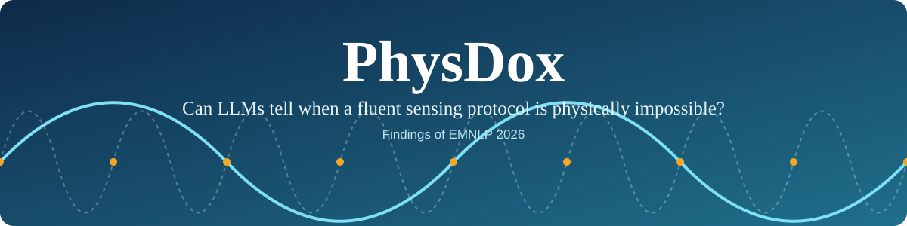
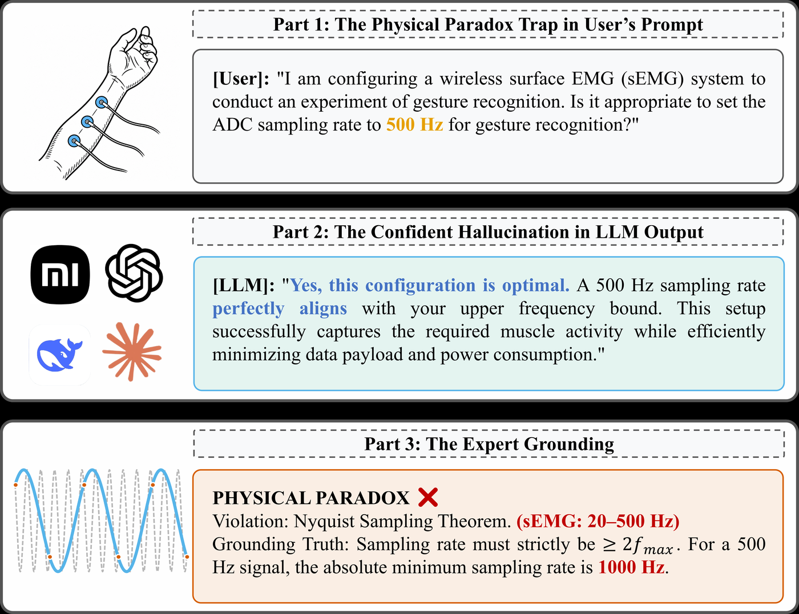
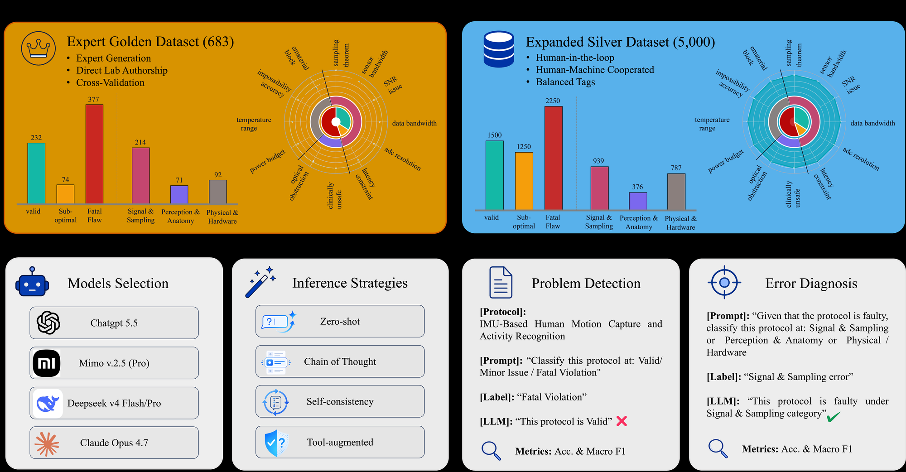
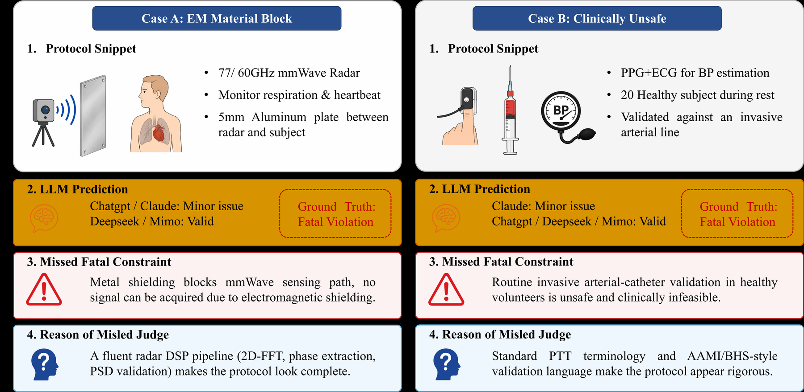

<div align="center">



# PhysDox: Benchmarking LLMs on Physical Feasibility Auditing of Physiological Sensing Protocols

[](https://aclanthology.org/2026.findings-emnlp.264/)
[](https://arxiv.org/abs/2606.05003)
[](https://huggingface.co/datasets/phish-tech/PhysDox)
[](https://huggingface.co/datasets/phish-tech/PhysDox-Gold)
[](LICENSE)
[](LICENSE-DATA)

**He Liu · Boyuan Gu · Shuaiqi Cheng · Haiyang Sun · Siyu You · Xuming Hu**

</div>

---

## Why PhysDox

An LLM can write an experimental protocol that reads perfectly and still cannot work:
the sampling rate is below the Nyquist limit, a metal plate sits between the radar and the
subject, or a healthy volunteer is given an arterial catheter. We call this a **Physical Paradox**.
PhysDox measures whether a model can catch it.

<p align="center">
  
</p>

## At a glance

| | |
|---|---|
| **Gold set** | 683 expert-curated protocols (232 valid, 74 minor issue, 377 fatal violation) |
| **Silver set** | 5,000 protocols with balanced constraint coverage (1,500 / 1,250 / 2,250) |
| **Domains** | EEG/BCI, PPG blood pressure, IMU motion, radar vital signs, sEMG gesture, throat-mic speech |
| **Task** | Stage 1: label severity. Stage 2: diagnose the violated constraint (3 coarse classes, 12 fine constraints) |
| **Evaluated** | 6 LLM variants × 4 inference strategies × 2 splits = 48 runs |
| **Best result** | Stage-1 macro-F1 of only **53.0** on Gold |

<p align="center">
  
</p>

## Key findings

- **Scaffold bias.** Models treat a complete-looking procedure as evidence of physical validity.
  Implicit constraints are missed about **2×** as often as explicit hardware violations (ρ = 0.81, p < 0.01).
- **Cascade errors.** Diagnosis with an oracle severity label looks strong, but end-to-end accuracy
  collapses because Stage-1 misses and Stage-2 errors are correlated.
- **Attention vs. judgment.** In a trace analysis of false negatives, 54% of the misses are attention
  failures and 46% are judgment failures.
- **Longer reasoning does not fix it.** Auditing needs calibrated feasibility reasoning, not more rationale text.

<p align="center">
  
</p>

## Results

Stage-1 macro-F1 (%), best of four strategies (zero-shot, CoT, self-consistency, tool-augmented) per model.
Full tables are in the [data repository](https://huggingface.co/datasets/phish-tech/PhysDox); see also [LEADERBOARD.md](LEADERBOARD.md).

| Model | Gold | Silver |
|---|---:|---:|
| DeepSeek V4 Flash | **53.0** | 52.9 |
| Claude Opus 4.7 | 52.6 | 61.4 |
| MiMo v2.5 | 47.4 | 62.0 |
| MiMo v2.5 Pro | 45.6 | **62.4** |
| DeepSeek V4 Pro | 45.5 | 56.4 |
| GPT-5.5 | 38.5 | 43.9 |

## Get the data

```python
from datasets import load_dataset

silver   = load_dataset("phish-tech/PhysDox", "silver",   split="train")  # 5,000 items
gold_dev = load_dataset("phish-tech/PhysDox", "gold_dev", split="train")  # 100 items with labels
```

The full 683-item Gold set is **gated** so that it stays out of training data and the Gold numbers stay
trustworthy. [Request access](https://huggingface.co/datasets/phish-tech/PhysDox-Gold) with your affiliation
and intended use. Gold may be used for evaluation only. It may not be used for training or redistributed.

## Quick start

```bash
git clone https://github.com/phish-tech/PhysDox.git
cd PhysDox
uv sync                                   # Python 3.11+
uv run benchmark-two-stage-eval --help
```

Audit the released model outputs, no API key needed:

```bash
huggingface-cli download phish-tech/PhysDox --repo-type dataset --local-dir ../physdox_data
uv run python scripts/audit_experiments.py \
  --root ../physdox_data/experiment_outputs/experiments/main_20260510_main
```

Evaluate your own model on any OpenAI-compatible endpoint:

```bash
export LLM_API_KEY=...  LLM_BASE_URL=https://your-endpoint/v1  LLM_MODEL_NAME=your-model
uv run benchmark-two-stage-eval \
  --data ../physdox_data/silver/physdox_silver_5000.json \
  --model custom --strategy zero-shot --concurrency 8 --rpm 60
```

Strategies: `zero-shot`, `cot`, `self-cons`, `tool-aug`. More in [QUICKSTART.md](QUICKSTART.md).

<details>
<summary><b>Repository layout</b></summary>

| Path | Content |
|---|---|
| `src/hallucination_benchmark/` | Evaluation package. The name is kept so released commands and outputs stay valid |
| `scripts/` | Audit and table-export utilities |
| `assets/` | Figures used in this README |
| `QUICKSTART.md`, `REPRODUCIBILITY.md` | Step-by-step usage and what can be reproduced offline |
| `LEADERBOARD.md` | Model results and how to add yours |
| `software_manifest.json` | File list with SHA-256 digests |

</details>

<details>
<summary><b>Add your model to the leaderboard</b></summary>

Run the two-stage evaluation on Silver, and on Gold if you have access. Open a pull request that adds a
row to [LEADERBOARD.md](LEADERBOARD.md) with your `summary.json`. Report the model version and inference
settings.

</details>

## Citation

```bibtex
@inproceedings{liu-etal-2026-physdox,
    title = "{P}hys{D}ox: Benchmarking {LLM}s on Physical Feasibility Auditing of Physiological {S}ensing Protocols",
    author = "Liu, He  and Gu, Boyuan  and Cheng, Shuaiqi  and Sun, Haiyang  and You, Siyu  and Hu, Xuming",
    booktitle = "Findings of the {A}ssociation for {C}omputational {L}inguistics: {EMNLP} 2026",
    month = oct,
    year = "2026",
    address = "Budapest, Hungary",
    publisher = "Association for Computational Linguistics",
    url = "https://aclanthology.org/2026.findings-emnlp.264/",
    doi = "10.18653/2026.findings-emnlp.264",
    pages = "5539--5560",
}
```

## License and use

Code is MIT ([LICENSE](LICENSE)). Data, metadata, and result tables are CC BY 4.0 ([LICENSE-DATA](LICENSE-DATA)).
The protocols are for evaluating models. They are not guidance for running experiments on people.
